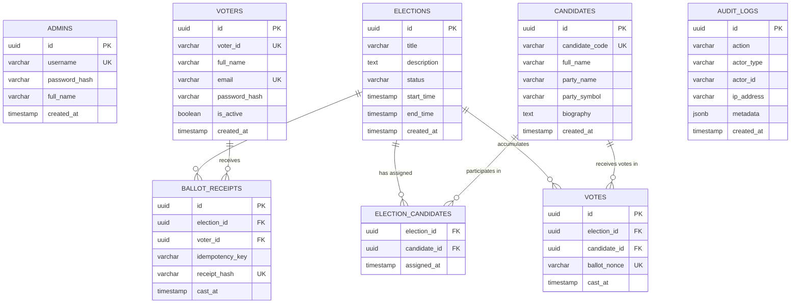

# Architecture & Technical Design: Secure Ballot Management Platform

**Document Version:** 1.0.0  
**Status:** Approved  
**Author:** Staff Backend & Systems Architect  
**Architecture Style:** Modular Monolith (C++20 Service + React/TypeScript SPA + PostgreSQL Persistence)  

---

## 1. Architectural Philosophy & Style

The platform is designed as a **Modular Monolith**. 

### Rationale:
1. **Appropriate Complexity:** A voting application in this domain manages tightly coupled state invariants (election lifecycle, candidate slates, voter rosters, ballot tallies). Decomposing this into microservices would introduce distributed transaction coordination (2PC/Saga), eventual consistency hazards, and network latency without any organizational or operational justification.
2. **ACID Transaction Boundaries:** Strict double-voting prevention and ballot secrecy require database-level atomicity and foreign key constraints across elections, candidates, voters, and ballots. A single relational database engine ensures zero divergence between voter eligibility and cast ballots.
3. **In-Process Performance:** C++20 provides zero-cost abstractions, deterministic memory management (RAII), and direct memory bandwidth execution for high-throughput ballot processing.
4. **Deployability & Operations:** A single binary backend with a static web frontend bundle eliminates multi-service deployment orchestrations (e.g., Kubernetes, service meshes) while running efficiently in both Docker containers and bare-metal environments.

```
+──────────────────────────────────────────────────────────────────────────────+
|                               Browser Client                                 |
|               (React 19 + TypeScript + Vite + Vanilla CSS)                   |
|   +────────────────────────────+            +────────────────────────────+   |
|   |   Voter Portal Workflow    |            |     Admin Dashboard        |   |
|   |  - Auth & Election List    |            |  - Candidate/Voter Roster  |   |
|   |  - Candidate Ballot Slate  |            |  - Election State Machine  |   |
|   |  - Review & Signed Receipt |            |  - Tally & Certification   |   |
|   +────────────────────────────+            +────────────────────────────+   |
+──────────────────────────────────────┬───────────────────────────────────────+
                                       │ HTTPS / JSON REST API
                                       ▼
+──────────────────────────────────────────────────────────────────────────────+
|                           C++20 Modular Backend                              |
|                                                                              |
|  [ API & HTTP Transport Layer ] (Multi-threaded Non-blocking Server)         |
|  ├── Route Handlers: /api/auth, /api/elections, /api/candidates, /api/votes   |
|  ├── Middleware: Auth (JWT/Sessions), CORS, Rate Limiter, Request Logger    |
|  └── Validation & Serialization: nlohmann/json, RFC 7807 Problem Details     |
|                                                                              |
|  [ Application Service Layer ]                                               |
|  ├── ElectionLifecycleService: State transitions & invariant checks          |
|  ├── VotingService: Idempotency tokens, double-vote check, ballot recording  |
|  ├── RosterService: Candidate enrollment & voter registry management         |
|  └── TallyService: Cryptographic vote aggregation & result certification     |
|                                                                              |
|  [ Domain Layer ] (Pure C++ Models & Business Rules)                         |
|  ├── Entities: Election, Candidate, Voter, BallotReceipt, Vote               |
|  ├── Value Objects: ElectionStatus, VoterId, Timestamp, ReceiptHash          |
|  └── Domain Invariants: EligibilityRule, OpenWindowRule, SlateRule           |
|                                                                              |
|  [ Security & Cryptography Infrastructure ]                                  |
|  ├── PasswordHasher: OpenSSL PBKDF2-HMAC-SHA256 (600,000 rounds) / bcrypt   |
|  ├── TokenManager: HMAC-SHA256 cryptographically signed session tokens       |
|  └── AuditLogger: Structured append-only security event audit trail          |
|                                                                              |
|  [ Persistence Layer ]                                                       |
|  ├── DatabaseConnectionPool: Thread-safe libpq connection pool               |
|  ├── Relational Repositories: Prepared statements, parameterized SQL         |
|  └── TransactionManager: ACID transactions, explicit ROLLBACK / COMMIT       |
+──────────────────────────────────────┬───────────────────────────────────────+
                                       │ libpq (TCP / UNIX Socket)
                                       ▼
+──────────────────────────────────────────────────────────────────────────────+
|                       PostgreSQL Relational Engine                           |
|  ├── Tables: voters, candidates, elections, election_candidates              |
|  ├── Decoupled Tables: ballot_receipts (voter_id)  vs  votes (candidate_id)  |
|  ├── Constraints: UNIQUE(election_id, voter_id), Composite Foreign Keys     |
|  └── Indexes: B-Tree indexes on lookup keys & foreign key relationships       |
+──────────────────────────────────────────────────────────────────────────────+
```

---

## 2. Component & Layer Responsibilities

### 2.1 Transport Layer (`src/api/`)
- Listens for HTTP requests on a configurable host/port.
- Manages connection lifecycle and thread pool dispatch.
- Parses request headers, query parameters, and JSON payloads.
- Enforces CORS policies, security headers, and rate limiting.
- Maps internal domain exceptions to standard HTTP response codes (200, 201, 400, 401, 403, 404, 409, 500).

### 2.2 Application Services (`src/services/`)
- Encapsulates business use cases and transaction boundaries.
- Orchestrates domain entity operations with repository persistence.
- Handles authorization checks before executing privileged actions.
- Coordinates audit logging for security-sensitive actions.

### 2.3 Domain Model (`src/domain/`)
- Pure business logic free of database, HTTP, or framework dependencies.
- Contains the Election State Machine and state transition validations.
- Validates entity invariants (e.g., date window validity, candidate ID formatting).

### 2.4 Security Subsystem (`src/security/`)
- Password hashing using established cryptographic standards (OpenSSL PBKDF2/SHA-256 with cryptographically random salt).
- Constant-time string comparison (`CRYPTO_memcmp`) to eliminate timing attacks.
- Cryptographic nonce and token generation (`RAND_bytes`).

### 2.5 Persistence Subsystem (`src/database/`)
- Thread-safe connection pool managing reusable PostgreSQL client connections.
- Parameterized query execution protecting 100% against SQL injection attacks.
- Explicit transaction wrappers supporting `BEGIN`, `COMMIT`, and `ROLLBACK` on error.

---

## 3. Database Architecture & Relational Schema

### 3.1 Relational Schema Diagram


### 3.2 Dual-Table Ballot Secrecy & Idempotency Architecture
A core engineering challenge in digital voting is **verifiable integrity vs voter privacy**:
- The system must verify that a specific voter cast a ballot in an election to prevent duplicate voting.
- The system must prevent anyone (including database administrators) from learning which candidate that voter voted for.

**The Solution:**
When a vote is submitted in an atomic transaction:
1. `BALLOT_RECEIPTS`: We insert `(election_id, voter_id, idempotency_key, receipt_hash, cast_at)`.
   - The database enforces `UNIQUE(election_id, voter_id)`. If the voter has already voted, this insertion throws a unique violation error (PostgreSQL error code `23505`), immediately aborting the transaction.
2. `VOTES`: We insert `(election_id, candidate_id, ballot_nonce, cast_at)`.
   - Contains NO `voter_id` column.
   - The insertion is completely independent of the receipt row.
3. Both operations execute within a single `BEGIN ... COMMIT` block.
4. If an identical request arrives with the same `(voter_id, idempotency_key)`, the service recognizes the idempotent replay and returns the previously generated `receipt_hash` without creating a second vote.

---

## 4. Concurrency & Race-Condition Engineering

### 4.1 The Concurrent Double-Vote Attack Scenario
Suppose an attacker attempts to double-vote by issuing simultaneous HTTP POST requests across multiple connections at time $t_0$:
- Request A arrives on Worker Thread 1.
- Request B arrives on Worker Thread 2.

**Failure Mode in Naive Implementations:**
1. Thread 1 queries: `SELECT COUNT(*) FROM votes WHERE voter_id = 123` -> returns 0.
2. Thread 2 queries: `SELECT COUNT(*) FROM votes WHERE voter_id = 123` -> returns 0.
3. Thread 1 inserts vote.
4. Thread 2 inserts vote.
*Result:* Corrupted election with duplicate votes.

**Our Engineered Mitigation:**
We do not rely on an application-level check. Instead:
1. Both worker threads open dedicated transactions.
2. Thread 1 attempts: `INSERT INTO ballot_receipts (election_id, voter_id, ...) VALUES ($1, $2, ...)`.
3. Thread 2 attempts the identical insert.
4. PostgreSQL's internal b-tree unique index locks the index page. Thread 1 acquires the slot; Thread 2 blocks on the lock.
5. Thread 1 commits.
6. Thread 2 wakes up, detects the unique constraint conflict on `UNIQUE(election_id, voter_id)`, and immediately fails with error `23505 (unique_violation)`.
7. Thread 2 automatically rolls back its transaction.
*Result:* Mathematically guaranteed at-most-once ballot recording.

---

## 5. Technology Stack Decisions & Evaluation

| Component | Selected Technology | Evaluated Alternatives | Decisive Engineering Reason |
|:---|:---|:---|:---|
| **Backend Language** | C++20 | Go, Rust, Java | Demonstrates mastery of modern C++ (RAII, concepts, move semantics, smart pointers), minimal memory footprint, and high-performance determinism. |
| **HTTP Engine** | High-performance C++ HTTP Engine (`cpp-httplib` + `nlohmann/json`) | Drogon, Crow, Boost.Beast | Header-only simplicity, zero brittle dynamic link dependencies on Windows/Linux, native OpenSSL integration, excellent thread-pool model, rock-solid stability. |
| **Database** | PostgreSQL 18 | SQLite, MySQL, MongoDB | Native relational constraints (`UNIQUE`, foreign keys), robust ACID transactions, high-concurrency multi-version concurrency control (MVCC), and enterprise observability. |
| **Frontend Framework**| React 19 + TypeScript + Vite | Angular, Vue, Next.js | Modern type safety, rapid component lifecycle, zero runtime overhead for static builds, universal developer familiarity. |
| **Styling** | Vanilla CSS Design System | TailwindCSS, Bootstrap | Maximum layout control, custom glassmorphism & dark-mode tokens, lightweight bundle size with zero framework bloat. |
