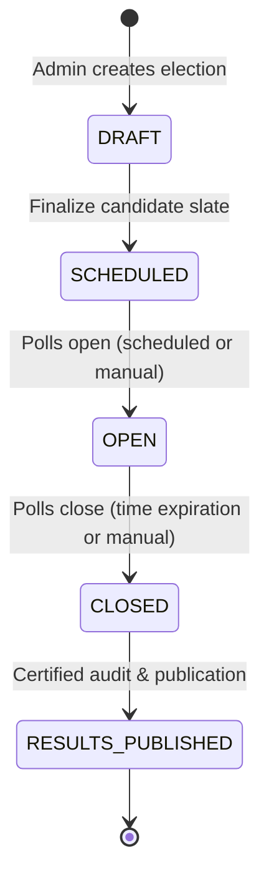

# Chapter 3 & 4: Requirements Engineering, Election Lifecycle & Core Invariants

## 1. Functional & Non-Functional Specifications

A robust software platform begins with unambiguous specification boundaries. AegisVote distinguishes between administrative governance and voter participation capabilities.

### 1.1. Administrator Capabilities
1. **Authentication & Role-Based Access Control**:
   - Secure login via username and cryptographically verified password.
   - Distinct roles: `SUPER_ADMIN` and `ELECTION_OFFICER`.
   - Access to audit logs, election configuration, candidate assignment, and voter registration.
2. **Candidate & Voter Roster Management**:
   - Enrollment of political candidates with full name, candidate code, party name, party symbol, and manifesto biography.
   - Voter registration generating unique voter identity codes and initial PBKDF2 credential hashes.
3. **Deterministic Lifecycle Orchestration**:
   - Creating elections with start and end timestamps.
   - Transitioning election states along an immutable state machine.
   - Assigning candidate slates strictly during preparation phases.
   - Publication of certified election results post-closure.
4. **Security & Tamper Audit**:
   - Immutable logging of all state transitions, voter enrollments, candidate assignments, and ballot attempts.

### 1.2. Voter Capabilities
1. **Secure Identity Verification**:
   - Authentication via unique Voter ID and high-entropy password.
   - Issuance of cryptographically signed Bearer tokens (HMAC-SHA256).
2. **Eligibility & Participation Introspection**:
   - Listing all available elections with status indicators.
   - Inspecting candidate slates for open ballots.
   - Real-time verification of voter eligibility and participation flags (`has_voted`).
3. **Ballot Submission & Secrecy**:
   - Casting exactly one vote per election for an enrolled candidate.
   - Receiving an immutable, cryptographically sealed Ballot Receipt (`SHA-256 HMAC`).
   - Rejection of duplicate voting attempts with explanatory RFC 7807 problem details.
4. **Certified Results Verification**:
   - Viewing certified tallies and candidate percentages once the election is published.

---

## 2. Deterministic Election Lifecycle State Machine

To prevent procedural anomalies, an election progresses through five strictly validated states:



### 2.1. Formal Transition Matrix

| From State | Allowed Target State | Permitted Operations | Forbidden Operations |
| :--- | :--- | :--- | :--- |
| **`DRAFT`** | `SCHEDULED` | Assign candidates, edit title/description, assign voters. | Voting, tally generation, publishing results. |
| **`SCHEDULED`**| `OPEN`, `DRAFT` | Review candidate slate, inspect voter eligibility. | Voting, candidate modifications once scheduled. |
| **`OPEN`** | `CLOSED` | **Ballot submission permitted**, voter status checks. | Candidate assignment, modifying dates, tally disclosure. |
| **`CLOSED`** | `RESULTS_PUBLISHED`| Audit log review, preliminary tally certification. | Ballot submission (**strictly rejected**), candidate changes. |
| **`RESULTS_PUBLISHED`**| *(Terminal)* | Public tally inspection, receipt hash verification. | All mutations, voting, candidate assignments. |

### 2.2. Mathematical Transition Guard in C++20

In AegisVote, illegal transitions are prevented in domain code before reaching the database:

```cpp
// include/domain/ElectionStatus.hpp
inline bool canTransition(ElectionStatus from, ElectionStatus to) {
    switch (from) {
        case ElectionStatus::Draft:
            return to == ElectionStatus::Scheduled;
        case ElectionStatus::Scheduled:
            return to == ElectionStatus::Open || to == ElectionStatus::Draft;
        case ElectionStatus::Open:
            return to == ElectionStatus::Closed;
        case ElectionStatus::Closed:
            return to == ElectionStatus::ResultsPublished;
        case ElectionStatus::ResultsPublished:
            return false; // Terminal state
        default:
            return false;
    }
}
```

---

## 3. The 7 Core Invariants & Correctness Guarantees

In financial and ballot systems, an **invariant** is a property that must remain true under all circumstances, across every execution path, during concurrent requests, and in the presence of process crashes or network retries.

AegisVote establishes seven non-negotiable invariants:

### Invariant 1: Eligibility Precondition
> **"A ballot can only be accepted if the voter is actively enrolled and marked eligible for the target election."**

- **Enforcement**: Prior to inserting a ballot, the service queries `election_voters` verifying `is_eligible = TRUE` and `voters.is_active = TRUE`.
- **Attack Prevented**: Cross-district ballot injection or voting by deactivated/disenfranchised accounts.

### Invariant 2: Exactly-Once Participation (Double-Vote Prevention)
> **"A voter can cast at most one accepted vote per election."**

- **Enforcement**: Enforced at the persistence layer by `ballot_receipts(UNIQUE(election_id, voter_id))` inside an atomic transaction.
- **Attack Prevented**: Replay attacks, multi-tab ballot submissions, distributed race conditions.

### Invariant 3: Temporal Bounding (Lifecycle Validity)
> **"Votes can only be cast when the election status is strictly `OPEN`."**

- **Enforcement**: In domain logic and verified inside the database transaction using `SELECT status FROM elections WHERE id = $1 FOR SHARE;`. If `status != 'OPEN'`, the transaction raises an exception and aborts.
- **Attack Prevented**: Early voting before poll opening; late ballot injection after poll closure.

### Invariant 4: Candidate Slate Integrity
> **"A vote can only be recorded for a candidate officially assigned to the election receiving the vote."**

- **Enforcement**: Relational integrity check against `election_candidates(election_id, candidate_id)`.
- **Attack Prevented**: Voting for fictitious candidates or candidates running in a different election.

### Invariant 5: Idempotent Network Retries
> **"Repeated HTTP requests bearing the same client `Idempotency-Key` must return the original receipt without duplicating vote counts."**

- **Enforcement**: `ballot_receipts.idempotency_key` unique lookup before attempting row insertion.
- **Attack Prevented**: Client network dropouts on 3G/4G connections causing accidental duplicate vote submissions.

### Invariant 6: Ballot Secrecy & Decoupling
> **"The storage of voter participation must be physically separated from the recording of candidate choice."**

- **Enforcement**: Dual-table relational schema. Voter ID and timestamp are stored in `ballot_receipts`. Candidate ID, random ballot nonce, and timestamp are stored in `votes`. No foreign key or joinable pointer connects the two rows.
- **Attack Prevented**: Coercion, vote buying, or internal administrator surveillance of voter political choices.

### Invariant 7: Results Consistency
> **"Published results must exactly equal the aggregate tally of valid rows in the `votes` table for that election."**

- **Enforcement**: `SUM(tally) == COUNT(ballot_receipts)`. A tamper-evident database trigger blocks manual `UPDATE` or `DELETE` on the `votes` table.
- **Attack Prevented**: Post-hoc tally alteration or ballot subtraction.
